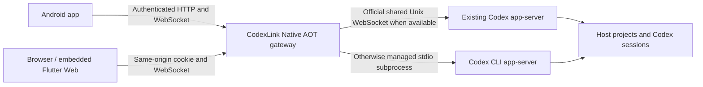

# CodexLink

[English](README.md) | [简体中文](README.zh-CN.md)

**Continue your computer's Codex sessions from an Android phone or a browser.**

CodexLink is a self-hosted, single-user remote client for Codex. A small .NET 10 Native AOT gateway runs on your computer, talks to the official `codex app-server`, and serves a Flutter web client from the same executable. The Flutter Android app connects to that gateway. Your projects and conversation history remain with Codex on the host.

[Download a release](https://github.com/mysteriousmy/CodexLink/releases/latest) · [Deployment guide](deploy/README.md) · [Verification record](docs/verification.md) · [MIT license](LICENSE)

CodexLink is an independent project, not an official OpenAI product. It does not bundle Codex or bypass its authentication, permissions, sandbox or approvals. The current application UI is primarily Simplified Chinese; the documentation is available in English and Simplified Chinese.

## Screenshots

Real Web and Android Release UI with fictional demo conversations, projects and usage data. No personal sessions, account credentials or private workspace content are shown.


<p align="center">
  
  &nbsp;&nbsp;
  
</p>

## What you can do

- **Resume existing sessions.** Browse conversations across local working directories, search titles, filter by native Codex project, load more history automatically, and inspect or restore archived sessions. Sessions keep their original IDs and settings.
- **Keep working while away from the computer.** Stream intermediate commentary and final replies, see tool activity, respond to approvals, stop a turn, or steer an active turn without restarting it.
- **Send real attachments.** Choose files in the app, drop files into the web client, or paste clipboard files/images into the web composer. Upload progress, cancellation, retry and image preview are supported. An upload becomes a message attachment only when you send it.
- **Choose session permissions.** Read only, Default, Auto-review and Full access use native Codex settings, respect managed restrictions and synchronize across clients. Existing custom settings are preserved.
- **Use native Goals.** Toggle Goal mode in the composer and send the current text as a native Codex goal. View, edit, pause, resume and remove an existing goal. Goals are not client-only to-do items.
- **Use skills, workspace references and MCP.** `/skills`, `@file`, `/mcp` and `/goal` open actual protocol-backed functionality rather than disguising commands as prompt text.
- **Read changes and media.** Open colored file diffs with line numbers, inspect image results, preview local files and animated SVGs, and download attachments.
- **Understand usage.** View conversation tokens, context usage, Goal consumption and the account usage/quota data exposed by Codex. Missing metrics stay unknown instead of being displayed as zero.
- **Use a phone-sized interface.** Compact session navigation, dark/light themes, keyboard-aware composition and Android system-back navigation. Returning to the list keeps the draft.

## How it works



The gateway has no business database and does not copy or read Codex's private conversation database/logs. It stores only its own configuration, token hashes, uploaded files and bounded preview/cache state. Existing conversations are restored through official protocol calls. The preferred shared-daemon connection owns only its socket; closing CodexLink does not terminate that shared daemon.

## Download the right package

### Server

| Host | Release asset | Compression |
| --- | --- | --- |
| Linux x86-64 | `CodexLink-v<VERSION>-linux-x64.tar.gz` | Native AOT + UPX |
| Linux ARM64 / aarch64 | `CodexLink-v<VERSION>-linux-arm64.tar.gz` | Native AOT + UPX |
| Windows x64 | `CodexLink-v<VERSION>-windows-x64.zip` | Native AOT + UPX |
| Windows ARM64 | `CodexLink-v<VERSION>-windows-arm64.zip` | Native AOT; UPX does not support ARM64 PE |

Each archive includes the executable, **credential-format placeholders only**, example configuration, English/Chinese placement and startup instructions, licenses and `build-info.json`. No real login token, account state, attachment, private signing key or local machine configuration is included. Linux archives also contain `install-systemd.sh` and optional systemd templates. The .NET runtime is not required on the target machine.

Linux packages use **musl with fully static native linking** (`linux-musl-x64` / `linux-musl-arm64`). They have no dynamic loader or shared-library dependencies, statically link OpenSSL, and omit ICU through invariant globalization. Named time zones still use the OS tzdata files; HTTPS certificate verification uses the OS trust store. Codex remains a separate executable. See the [deployment guide](deploy/README.md). Cross-compilation is not a claim of full target-hardware validation: the release notes distinguish native tests, emulation and compile-only checks.

### Android

| Asset suffix | Device |
| --- | --- |
| `android-arm64-v8a.apk` | Most current ARM64 phones; recommended when applicable |
| `android-armeabi-v7a.apk` | Supported 32-bit ARM devices |
| `android-x86_64.apk` | 64-bit Intel/AMD Android devices and emulators |
| `android-universal.apk` | All three supported ABIs in one larger APK |

Minimum Android version is determined by the pinned Flutter toolchain (currently Android 7.0 / API 24). The Intel build is **x86_64**, not legacy 32-bit x86; Flutter release mode does not support that legacy ABI. APKs are signed with the project's release certificate so subsequent official versions can update the same installation. Self-built APKs use your own private signing key.

All four v0.1.1 server packages passed [native-platform smoke tests](https://github.com/mysteriousmy/CodexLink/actions/runs/40047630023), including all four permission modes; both Linux architectures also passed the 37-test gateway contract suite. Tests use a fake Codex process. See the [verification record](docs/verification.md) for the scope and real-device limitations.

Download `SHA256SUMS` alongside the assets. On Linux/macOS run `sha256sum -c SHA256SUMS` in a directory containing the downloaded files, or compare the specific file's hash. On Windows use `Get-FileHash .\<asset> -Algorithm SHA256` and compare it with the matching entry.

## Quick start

### 1. Prepare the host

Install and authenticate [Codex CLI](https://github.com/openai/codex) under the account that will run the gateway. CodexLink has been exercised with Codex CLI `0.163.0` and shared app-server `0.157.1`; it uses recent project, Goal and usage APIs, so older builds may lack capabilities. Codex is a separate prerequisite and any model access is governed by your Codex account/provider.

### 2. Initialize the gateway

Linux, from an extracted archive:

```bash
chmod +x ./CodexLink.Server
export CODEXLINK_DATA="$HOME/.local/share/codexlink"
./CodexLink.Server --init
./CodexLink.Server
```

Windows PowerShell, from an extracted archive:

```powershell
$env:CODEXLINK_DATA = Join-Path $env:LOCALAPPDATA 'CodexLink'
.\CodexLink.Server.exe --init
.\CodexLink.Server.exe
```

`--init` is for a **new** state directory. It creates `config.json` and a random token in `access-token.txt`. The startup console prints the GUI login key and accessible IPv4 URLs. Do not publish that output. If Windows cannot launch Codex, set `codexPath` in the generated config to the native `codex.exe`; an npm `codex.cmd` shim is not suitable.

### 3. Connect

- Host browser: open `http://127.0.0.1:47821`.
- Phone on the same private LAN: open the host's printed LAN address, or enter it in the Android app.
- Enter the **CodexLink gateway token**, not an OpenAI API key.
- Select an existing conversation, or create one using a native Codex project or the host directory picker.

The server binds to `0.0.0.0:47821` by default. `0.0.0.0` is a listener address, not an address to type into a browser. For access outside the private LAN, configure your own HTTPS endpoint as described below.

To install the Linux package as a system service, run `sudo ./install-systemd.sh` from the extracted directory. It defaults to `/opt/codexlink`, private state at `/var/lib/codexlink`, and the invoking non-root user. It preserves existing state, enables startup and restarts the service. Use `--user USER` and `--codex /absolute/path` if needed; see the [deployment guide](deploy/README.md).

## Daily use

The mobile session list keeps search and project filtering near the top; account details open from the bottom row. The overflow menu contains new Goal, archive filtering, refresh, theme and disconnect actions. On a wider screen, navigation and the conversation appear together.

Enter a normal message and press **Send**. While a turn is active, the same action becomes **Steer** and targets that exact turn. If the turn changed or the result is uncertain, the draft remains available for review. Desktop/web Enter sends; Shift+Enter inserts a newline. IME composition does not send a message prematurely.

Use the flag in the composer to turn the current text into a Goal; toggling it alone does not submit anything. Active/paused goals appear in a compact bar above the composer. Completed goals do not occupy the message area. Existing-goal controls and turn interruption have distinct protocol semantics.

The shield beside the model selects the current session's permissions in both App and Web:

| Mode | Sandbox | Approval handling |
| --- | --- | --- |
| Read only / 只读 | Read-only filesystem | Ask you when an action needs escalation |
| Default / 默认 | Workspace write | Ask you when an action needs escalation |
| Auto-review / 自动审查 | Workspace write | Codex automatically reviews eligible escalation requests |
| Full access / 完全访问 | No sandbox | No routine approval prompts; host files and network are accessible |

New sessions use **Default**. Existing sessions retain their actual settings, including custom profiles. Choose a mode explicitly while the turn is idle and the Goal is paused; the confirmed setting applies to subsequent turns. Managed restrictions disable unavailable modes, and changes made in another client synchronize automatically. Auto-review does not expand the sandbox. These modes use Codex's [permission profiles](https://learn.chatgpt.com/docs/permissions) and [automatic review](https://learn.chatgpt.com/docs/sandboxing/auto-review), without editing your global Codex configuration.

Attachments are uploaded before submission. Defaults are 25 MiB per file, 10 files and 100 MiB per message, and 1 GiB of attachment storage. Web paste requires the clipboard to contain a real file/image; a path string alone cannot grant the browser access to your local filesystem. Plain text remains plain text.

Scroll toward the end of the session list to fetch more sessions. Scroll toward the beginning of a conversation to load earlier messages while keeping the reading position. Click a changed file to open its full-screen diff.

<details>
<summary>See the permission picker</summary>


</details>

## Configuration and data

The full format is in [config.example.json](deploy/config.example.json). Generate your own live configuration with `--init` and then edit it; do not use placeholder credentials.

| Setting / environment variable | Meaning |
| --- | --- |
| `CODEXLINK_DATA` | Private state directory; otherwise uses OS local application data + `codexlink` |
| `listenUrl` | HTTP listener; default `http://0.0.0.0:47821` |
| `publicOrigin` | Exact HTTPS browser origin when using a reverse proxy, without a trailing slash |
| `codexPath` | Codex executable name or absolute native executable path |
| `preferSharedDaemon` | Prefer an existing compatible local daemon; default `true` |
| `codexSocketPath` | Optional explicit shared Unix socket path |
| `codexArguments` | Default `app-server --listen stdio://` fallback arguments |
| `devices` | Device IDs/names and SHA-256 token hashes; manage with CLI commands |
| `maxFileBytes` / `maxStorageBytes` | Per-upload and aggregate attachment storage limits |
| `timeZone` | Time zone used for daily usage; new initialization uses the host's local zone |
| `CODEXLINK_WEB_ROOT` | Explicit development-only override for the embedded web root |

Create a separate device credential or revoke one:

```bash
./CodexLink.Server --create-token --name "Phone" --output /private/path/phone-token.txt
./CodexLink.Server --revoke-token DEVICE_ID
```

Restart after management commands or configuration edits. Creating a new token does not automatically revoke older ones. Keep your state directory when upgrading; backup of Codex's own state is a separate concern. [Package placement and service instructions](deploy/README.md) cover Linux user/system systemd services and Windows console/Task Scheduler operation.

## Remote access and security

The intended deployment is one person controlling their own trusted computer. APIs, WebSockets and file resources require authentication. Browser requests use same-origin HttpOnly cookies; HTTPS adds Secure cookies. Android stores the token using platform secure storage. Cookie writes and WebSocket connections validate their origin.

Private-LAN and loopback HTTP are supported for direct local use. Use HTTPS for remote access. A reverse proxy should forward WebSocket upgrades, allow the configured upload size and preserve an idle timeout longer than the heartbeat interval. Set `publicOrigin`, for example `https://codex.example.com`; use a loopback listener if only the local proxy should reach the gateway. CodexLink does not install a tunnel or open router ports for you.

The gateway respects Codex sandboxing and approvals. Its HTTP API does not expose arbitrary shell execution or unrestricted RPC forwarding. The startup console **does print the GUI token**, so journal files and captured console output must remain private. Never commit your state directory, token files, `.env`, Android `key.properties`, signing keystore or browser authentication state.

## Build locally

### Toolchain

| Tool | Current version / purpose |
| --- | --- |
| .NET SDK | `10.0.302`, pinned in `global.json` (latest patch roll-forward allowed) |
| Flutter / Dart | Flutter `3.47.5`, Dart `3.13.4`; `pubspec.lock` pins Dart packages |
| StuDev.AotAnywhere | `1.1.0`, pinned as an MSBuild SDK; restores its Zig toolchain |
| Docker | Linux container engine for static musl releases; ARM64 support or binfmt/QEMU when building ARM64 on x64 |
| Python | 3.11+ for packaging and black-box tests |
| UPX | 5.x; needed by the default release packaging command |
| Android build tools | Android SDK/NDK required by Flutter and a compatible JDK; the current build was tested with JDK 25 |
| Chrome | Only needed for browser-specific clipboard tests |

Install these using their official distributions, ensure they are on PATH, and run `flutter doctor -v`. Linux release builds use the digest-pinned Alpine SDK image in `scripts/Dockerfile.musl` (.NET SDK 10.0.402). Docker installs clang, static OpenSSL and zlib inside that build image. Host .NET builds use SDK 10.0.302 from `global.json`. Install `binutils` (`readelf`) for static-ELF validation. On an x64 Linux host, enable your distribution's ARM64 binfmt/QEMU support before requesting ARM64; Docker Desktop normally provides emulation. The script does not change host binfmt registrations. Windows native builds require the Visual Studio C++ toolchain used by .NET Native AOT; cross-OS builds on Linux/macOS use AotAnywhere. Version numbers above describe the tested toolchain, not a requirement to upgrade your system globally.

```bash
git clone https://github.com/mysteriousmy/CodexLink.git
cd CodexLink
flutter --no-version-check doctor -v
python3 scripts/build-release.py --all --android
```

On Windows use `python` instead of `python3`. On Bash, `./scripts/build-release.sh` is a convenience wrapper around the same Python script.

The script runs Flutter dependency restore, static analysis and unit/widget tests, builds Flutter Web once and embeds that exact output in every requested server RID, UPX-packs supported binaries, and creates the archives. `--android` creates/retains a **local private release keystore**, builds the three split APKs plus universal APK, and adds them to `artifacts/v<VERSION>/`. Signing secrets remain in ignored `.local/` and `client/android/key.properties`; back them up privately to retain update compatibility.

Useful build variants:

```bash
# One server architecture; default if no RID argument is supplied
python3 scripts/build-release.py --rids linux-musl-x64

# Only the Windows server targets
python3 scripts/build-release.py --rids win-x64 win-arm64

# Unpacked binaries, or a version override
python3 scripts/build-release.py --all --no-upx --version 0.1.1

# Skip already completed Flutter checks during a local packaging retry
python3 scripts/build-release.py --all --skip-checks
```

Ordinary AOT builds are retained separately. They use the standard glibc Linux / Windows toolchain, preserve Debug/Release selection, require no Docker or UPX, and never overwrite release archives:

```bash
python3 scripts/build-aot.py --rids linux-x64 win-x64
python3 scripts/build-aot.py --rids linux-x64 --configuration Debug
# Bash wrapper: ./scripts/build-aot.sh <same arguments>
```

Their output is `artifacts/aot/<Debug|Release>/<RID>/`. glibc builds retain their normal ICU/OpenSSL/native-library requirements. They embed the matching Flutter Web build just like before.

Direct builds remain available:

```bash
dotnet build server/CodexLink.Server -c Debug
# Static Linux distribution build (Alpine container + UPX + archive)
python3 scripts/build-release.py --rids linux-musl-x64
cd client
flutter --no-version-check run
```

`dotnet build` and `dotnet publish` automatically generate the corresponding Debug/Release Flutter web output and embed it before compilation. No runtime extraction or `wwwroot` directory is required. A standalone web dev server needs a same-origin API proxy to exercise gateway features. Direct `dotnet publish` does not run the Python packager/UPX; use the release script for final distribution archives.

### Size optimization

Release enables full trimming, size-oriented native compilation, identical-method folding and dehydrated runtime data. Managed stack-trace metadata, debugger/hot-reload support, EventSource diagnostics and framework message text are removed where supported. Debug builds retain debugging support. Linux release builds disable ICU with invariant globalization. UTF-8/Chinese text and JSON remain supported; locale-specific collation and formatting are intentionally unavailable. IANA time-zone lookup uses system tzdata. Windows keeps its platform globalization support, including IANA/Windows time-zone mapping.

The web bootstrap selects the universal CanvasKit renderer. Only that renderer is embedded, excluding unused Chromium/Skwasm/Wimp variants and debug symbol files. Chinese, emoji and monospace fonts and all license notices remain bundled. UPX then compresses the finished executable, with `upx -t` checking the result. Windows ARM64 is the documented exception. See each package's `build-info.json` and the release notes for measured sizes.

Packed Windows binaries may trigger security-product heuristics; build with `--no-upx` if your environment requires unpacked executables. Windows packages are not Authenticode-signed.

### Tests

```bash
cd client
flutter --no-version-check analyze
flutter --no-version-check test
flutter --no-version-check test --platform chrome test/web/clipboard_test.dart
cd ..

# Linux: managed-server or Native AOT black-box tests with deterministic fake Codex peers
./scripts/test-gateway.sh
CODEXLINK_TEST_COMMAND="$PWD/.local/release-v0.1.1/linux-musl-x64/CodexLink.Server" \
  .local/test-venv/bin/python -m unittest discover -s tests -v
```

Create the test environment once with `python3 -m venv .local/test-venv` and `.local/test-venv/bin/python -m pip install -r tests/requirements.txt`. Set `CHROME_EXECUTABLE` when Chrome is outside the default location. Point `CODEXLINK_TEST_COMMAND` at the **extracted release executable** to test the UPX-packed version itself. Tests use isolated temporary state and fake protocol peers, not real model calls.

## Limits and troubleshooting

- **Cannot start Codex:** check the service account, `codexPath`, CLI login and executable permissions. On Windows select the native `.exe`, not a `.cmd` wrapper.
- **Login rejected on a remote address:** check HTTPS and the exact `publicOrigin`. A benchmark/TUN/non-private address is not automatically treated as a private LAN.
- **Linux timezone/certificate data missing:** install `tzdata` for named zones and `ca-certificates` for HTTPS certificate validation, or use UTC if appropriate. These are data files, not dynamic-library dependencies. The gateway itself does not need ICU, a musl loader or a shared OpenSSL library.
- **Conversation is read-only:** a separate CLI may hold the thread lock, or the session may be archived. Release the owner/restore the archive explicitly, then synchronize.
- **An account metric is missing:** the UI reports unknown data; it does not estimate account totals from client messages.
- **A phone disconnects:** accepted work continues while its host app-server remains alive. Reconnect to reconcile progress; do not assume process restarts preserve in-flight approvals or deduplication caches.
- **iOS:** the Flutter iOS project is present, but signing/building requires macOS/Xcode. No iOS binary is distributed here.
- **Long background sessions and real mobile networks:** emulator tests do not prove all sleep, roaming or network conditions. See [verification and limits](docs/verification.md).

## Repository map

```text
client/                     Flutter Android / iOS / Web application
server/CodexLink.Server/     .NET gateway and embedded-web build targets
scripts/                    Build, signing preparation and verification helpers
deploy/                     Public configuration examples and service templates
tests/                      Gateway black-box tests and deterministic Codex peers
docs/                       Architecture, design and validation notes
```

Most engineering notes in `docs/` are currently in Simplified Chinese. Start with [architecture](docs/architecture.md), [client structure](client/README.md) or [server structure](server/README.md). Contributions should preserve protocol ownership, bounded state, origin checks and AOT compatibility; see [AGENTS.md](AGENTS.md).

## License

CodexLink's own code is [MIT licensed](LICENSE). Bundled runtimes, fonts and other dependencies retain their own licenses; see [THIRD_PARTY_NOTICES.md](THIRD_PARTY_NOTICES.md). No private host credentials or signing material are required to build from source.
