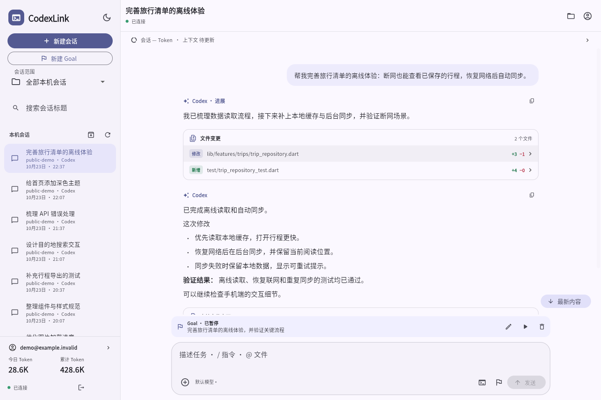
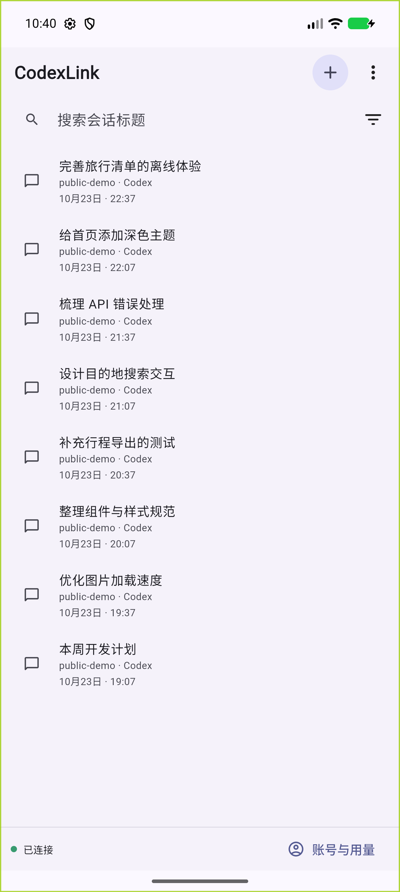
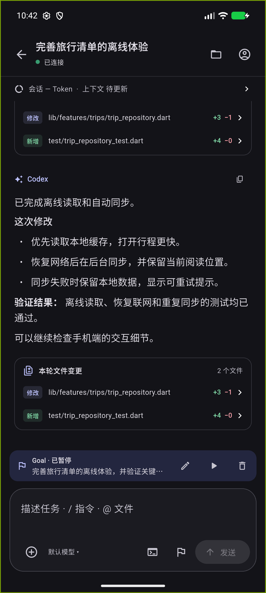
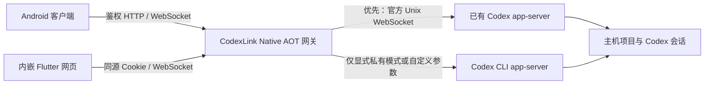
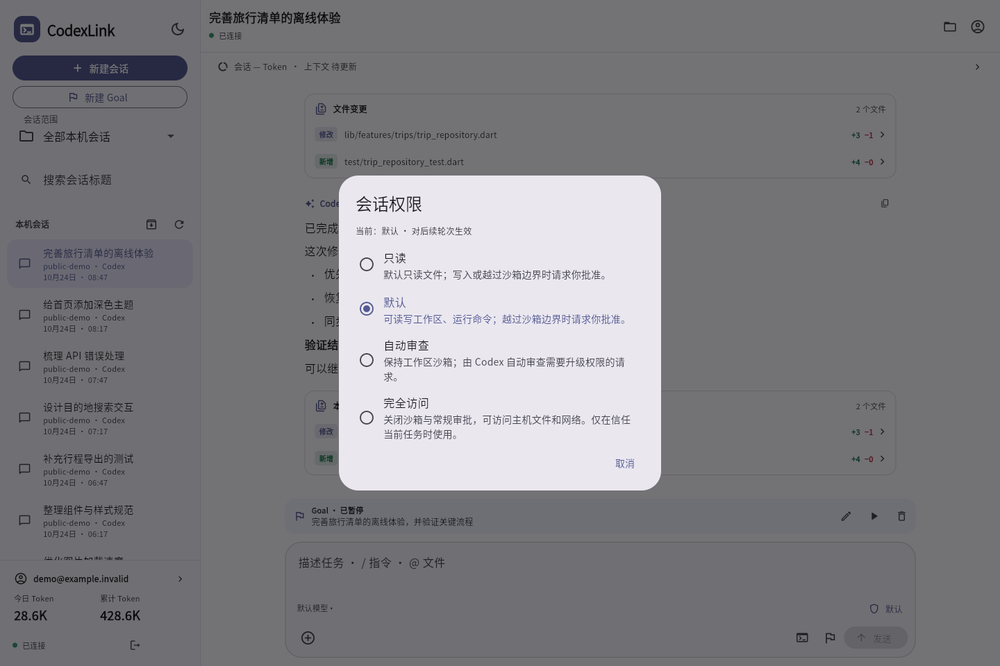

# CodexLink

[English](README.md) | [简体中文](README.zh-CN.md)

**通过 Android 手机或浏览器，继续电脑上的 Codex 会话。**

CodexLink 是面向个人的自托管 Codex 远程客户端。电脑运行一个 .NET 10 Native AOT 网关，与官方 `codex app-server` 通信；同一个可执行文件内嵌 Flutter 网页，Android 客户端也连接该网关。项目和会话历史仍由主机上的 Codex 管理。

[下载 Release](https://github.com/mysteriousmy/CodexLink/releases/latest) · [部署说明](deploy/README.zh-CN.md) · [验证记录](docs/verification.md) · [MIT 协议](LICENSE)

这是独立项目，不是 OpenAI 官方产品。它不包含 Codex，不绕过 Codex 登录、权限、沙箱或审批。当前应用界面以简体中文为主，项目文档提供英文和简体中文。

## 运行截图

以下是 Web 和 Android Release 客户端的实际运行界面，全部使用虚构的演示会话、项目与用量数据，不包含真实用户会话、凭据或私有工作区内容。



<p align="center">
  
  &nbsp;&nbsp;
  
</p>

## 主要功能

- **任务提醒**：Android 在 App 后台接收完成/失败通知；Web 有权限时弹系统通知，否则在右上角显示气泡，点击打开对应会话。

- **接续已有会话**：列出本机不同目录、来源和模型提供商的会话，支持标题搜索、原生项目筛选、下拉刷新、自动分页和归档查看；保留原会话 ID 与配置。
- **远程执行与干预**：实时显示中间说明、最终回复及工具活动，处理审批、中断轮次，或通过原生 steer 引导正在执行的轮次。
- **选项问答**：支持等待回答的原生问题与执行中的异步问题；显示选项说明、多个问题、自由回答和遮蔽的私密输入，提交时保留聊天草稿、附件与 Goal 设置。
- **文件与图片附件**：App 文件选择、网页拖放和剪贴板真实文件/图片粘贴；支持上传进度、取消、重试与图片预览。上传完成后仍需发送才会提交附件。
- **会话权限切换**：只读、默认、自动审查、完全访问四档对接 Codex 原生设置，遵守管理策略，跨客户端同步，保留已有自定义权限。
- **原生 Goal**：输入框切换目标模式，将当前文字提交为 Codex Goal；可查看、编辑、暂停、恢复和删除，保留真实预算与状态。
- **技能、工作区引用与 MCP**：`/skills`、`@file`、`/mcp`、`/goal` 对接实际目录及协议，不把命令伪装成普通提示词。
- **代码变更与媒体**：彩色文件 Diff、行号和全屏阅读；查看图片结果、本地文件、动画 SVG，并下载附件。
- **使用量与额度**：会话 Token、上下文占用、Goal 消耗及 Codex 提供的账号用量和订阅额度；缺失值保持未知。
- **手机布局**：紧凑会话列表、明暗主题、输入法适配；Android 系统返回先返回列表并保留草稿。

## 管理会话

电脑网关和客户端更新到 **v0.1.8** 后，运行中的会话使用青绿色背景和“运行中”标记。App **长按会话**弹出 **归档** 和 **关闭** 操作；未运行的会话不显示关闭，归档列表中提供恢复。Web 保持原有的鼠标悬停、键盘聚焦和触摸滑动操作。

归档调用 Codex 原生归档接口并保留历史。关闭取消本网关对该实例的订阅；Codex 在会话空闲、其他客户端断开订阅且原生卸载延迟结束后卸载实例，此前显示 **等待卸载**。关闭不会主动停止轮次或暂停 Goal；如果实例由其他客户端持有且本网关尚未订阅，会明确返回无法卸载。再次打开时恢复原会话 ID 和历史，普通刷新不会自动重新加载。聊天草稿和引用保留。

## 开启任务通知

电脑网关和 Android App 都需更新至 v0.1.3 或更高版本。在会话列表更多菜单中打开 **任务通知 → 开启系统通知**，允许 Android 通知权限。要在锁屏后及时收到提醒，再点 **允许锁屏后台运行**；部分手机还需允许自启动与后台活动。Android 会保留一条低优先级的后台连接提示，无需 FCM 账号或第三方推送中转。

网页保持打开时自动接收提醒。HTTPS/localhost 可从同一菜单申请系统通知权限；没有权限或不支持的 HTTP 地址仍显示右上角可点击气泡。后台期间的气泡会等切回页面后再计时消失。关掉页面或浏览器后不再实时送达。两端更新至 v0.1.7 后，原生提问和异步提问也会显示带问题摘要的提醒；回答后清除对应提醒，点击打开对应会话。私密问题仅显示通用提示，不包含回复正文或答案。

通知对应网关实际接收到的**提问、轮次完成或失败**事件，包括在此启动、恢复或订阅过的会话；一轮结束不等于整个 Goal 完成。网关最多保留七天、256 条通知元数据，已启用的客户端断线后可补收；首次订阅只接收之后的事件。历史过期时明确提示。记录包含 ID、状态、时间和最多 240 字符的问题摘要，不保存答案或回复正文。Android 支持用户配置的局域网 HTTP 地址；通知设置会实时更新连接状态，断开时显示具体原因并提供 **立即重连**。

## 回答 Codex 问题

电脑网关和 Android App 更新至 v0.1.5 或更高版本后，待答问题统一显示在输入框上方的扁平提示条，点击 **回答问题** 打开下一组问题。选择选项，或在允许时选择 **其他回答**，填完所有问题后提交；不会自动提交推荐选项。私密输入遮蔽显示，问答草稿仅存于内存，关闭弹窗和断线重连后可继续填写，重启客户端或退出登录后清除。提交成功或其他客户端回答后，对应问题会消失；重连时从历史中的结构化答案恢复异步问题的回答状态。

异步答案使用 Codex 的结构化回答信封与原始问题 ID，按当前会话状态通过新轮次或原生 `turn/steer` 提交；兼容版本的 Codex TUI 能据此清除对应的 queued follow-up 项，不消耗输入框原有内容。提交结果不明时，**核对提交结果** 先查询状态，避免重复发送。旧版本 Codex 若没有输出结构化提问字段，仍可在消息中阅读问题并通过聊天输入框回答。

## 自动发送与手动排队

两端更新至 **v0.1.8** 后，空闲时默认发送开启新轮次；运行中默认补充先进入可撤回队列，当前轮次结束后由 Codex 自动发送。提示条提供 **立即 steer** 和 **撤回**；前者立即提交给当前轮次，不中断任务，后者恢复正文、附件和引用到草稿。提交后的实际处理时机仍由 Codex 决定；旧版已经提交的 steer 无法追溯撤回。Goal、问题与队列共用有界可滚动区域，未知结果先核对，不自动重发。

## 工作方式



网关开机启动时保持待机，打开客户端后才连接已有 Codex 或执行 `codex app-server daemon start`。健康检查和后台通知不会启动 Codex；启动失败会显示原因，可刷新会话列表重试。不安装 Codex 开机服务，不修改其全局配置。Windows 使用当前原生 Codex 程序并以同一非管理员账号运行；Linux 服务模板使用 `KillMode=process`，避免网关重启连带终止共享任务。

网关没有业务数据库，不复制或扫描 Codex 的私有会话数据库和日志。只保存自身配置、设备令牌摘要、上传附件与有界预览缓存；会话恢复走官方协议。连接共享 daemon 时只持有自己的连接，关闭网关不会结束该共享 daemon。

## 选择下载包

### 服务端

| 主机 | 文件 | 构建方式 |
| --- | --- | --- |
| Linux x86-64 | `CodexLink-v<版本>-linux-x64.tar.gz` | musl 完全静态 AOT + UPX |
| Linux ARM64 / aarch64 | `CodexLink-v<版本>-linux-arm64.tar.gz` | musl 完全静态 AOT + UPX |
| Windows x64 | `CodexLink-v<版本>-windows-x64.zip` | Native AOT + UPX |
| Windows ARM64 | `CodexLink-v<版本>-windows-arm64.zip` | Native AOT；UPX 不支持 ARM64 PE |

每个压缩包包含可执行文件、**仅作格式说明的密钥占位模板**、配置示例、中英文放置/启动说明、许可证及 `build-info.json`。Linux 包另含 `install-systemd.sh` 和可选 systemd 模板。包中不含实际登录密钥、账号状态、附件、签名私钥或本机配置，目标主机无需安装 .NET。

Linux 实际 RID 为 `linux-musl-x64` / `linux-musl-arm64`，OpenSSL 静态链接，并通过 invariant globalization 去除 ICU。可执行文件没有动态加载器或共享库依赖。命名时区仍使用系统 `tzdata`，HTTPS 证书验证使用系统信任库；这些是数据文件。Codex 仍须单独安装。编译成功、模拟器运行和目标硬件验证会在发布说明中区分。

### Android

| 文件后缀 | 适用设备 |
| --- | --- |
| `android-arm64-v8a.apk` | 当前多数 ARM64 手机，匹配时优先选择 |
| `android-armeabi-v7a.apk` | 支持的 32 位 ARM 设备 |
| `android-x86_64.apk` | 64 位 Intel/AMD Android 设备和模拟器 |
| `android-universal.apk` | 同时包含上述三种 ABI，体积较大 |

当前工具链最低支持 Android 7.0 / API 24。Intel 版本为 **x86_64**，Flutter release 不支持传统 32 位 x86 ABI。官方 APK 使用项目发布证书签名，后续版本可覆盖升级；自行编译会生成自己的私有签名密钥。

v0.1.7 的四个服务端包已通过[原生平台运行检查](https://github.com/mysteriousmy/CodexLink/actions/runs/40112034624)，包括自动 start/steer、提问通知摘要与清除、会话关闭/重开/归档/恢复、原生待发送队列、权限及内嵌网页；两个 Linux 架构另各通过 72 项网关契约测试。检查使用假 Codex，完整范围及真机限制见[验证记录](docs/verification.md)。

同时下载 `SHA256SUMS` 校验文件。Linux/macOS 可在包含下载文件的目录运行 `sha256sum -c SHA256SUMS`（未下载的文件会提示缺失），或单独比较目标文件摘要；Windows 用 `Get-FileHash .\文件名 -Algorithm SHA256` 对照对应条目。

## 快速开始

### 1. 准备主机

以运行网关的账号安装并登录 [Codex CLI](https://github.com/openai/codex)。本项目验证过 CLI `0.163.0` 与共享 app-server `0.157.1`，使用较新的 project、Goal 和 usage API；较旧版本可能缺少能力。Codex 与模型访问由你自己的账号/提供商管理。

### 2. 初始化与启动

Linux，进入解压目录：

```bash
chmod +x ./CodexLink.Server
export CODEXLINK_DATA="$HOME/.local/share/codexlink"
./CodexLink.Server --init
./CodexLink.Server
```

Windows PowerShell，进入解压目录：

```powershell
$env:CODEXLINK_DATA = Join-Path $env:LOCALAPPDATA 'CodexLink'
.\CodexLink.Server.exe --init
.\CodexLink.Server.exe
```

`--init` 用于全新状态目录，生成 `config.json` 和随机 `access-token.txt`。启动控制台会打印 GUI 登录密钥及可访问 IPv4 地址，请勿公开日志。Windows 无法启动 Codex 时，将生成配置的 `codexPath` 指向原生 `codex.exe`，不要使用 npm 的 `codex.cmd` 脚本。

### 3. 连接客户端

- 主机浏览器打开 `http://127.0.0.1:47821`。
- 同一私有局域网的手机使用主机打印的 LAN 地址，或在 Android App 中填写该地址。
- 输入 **CodexLink 网关密钥**，不是 OpenAI API Key。
- 选择已有会话，或使用原生项目/主机目录选择器新建会话。

默认监听 `0.0.0.0:47821`。`0.0.0.0` 是监听地址，不是浏览器访问目标。私有局域网以外的访问需要自行配置 HTTPS 入口。

Linux 解压目录运行 `sudo ./install-systemd.sh` 可安装系统服务：默认程序放 `/opt/codexlink`，私有状态放 `/var/lib/codexlink`，以调用 sudo 的普通账号运行，保留已有状态，启用开机自启并重启。可加 `--user USER`、`--codex /absolute/path`，详见[部署说明](deploy/README.zh-CN.md)。

## 日常使用

手机列表顶部保留搜索、项目筛选，底部一行打开账号与额度详情；更多菜单提供新建 Goal、归档筛选、刷新、主题和断开连接。宽屏同时显示侧栏与会话。

普通文字点击“发送”；轮次正在执行时改为“Steer”，只针对该轮次。轮次变化或结果不明时保留草稿，供确认状态后再操作。桌面/网页 Enter 发送，Shift+Enter 换行，输入法组合文字不会提前发送。

输入框旗帜切换 Goal 模式，切换本身不提交任务，发送时才使用当前文字创建目标。活跃/暂停 Goal 在输入框上方显示简栏；完成目标不挤占消息区域。目标暂停与中断当前轮次是不同操作。

App 和网页输入框的模型旁提供盾牌权限选择器：

| 档位 | 沙箱范围 | 审批方式 |
| --- | --- | --- |
| 只读 | 文件系统只读 | 需要升级权限时询问你 |
| 默认 | 工作区可写 | 需要升级权限时询问你 |
| 自动审查 | 工作区可写 | Codex 自动审查符合条件的权限升级请求 |
| 完全访问 | 关闭沙箱 | 不进行常规审批，可访问主机文件和网络 |

新会话使用“默认”；已有会话保留实际设置，自定义配置显示为“自定义权限”。当前轮次结束、Goal 暂停后才可切换，等待 Codex 确认后对后续轮次生效。管理策略禁止的档位不可选，其他客户端修改权限会实时同步。“自动审查”保留沙箱范围。实现使用 Codex 原生[权限配置](https://learn.chatgpt.com/docs/permissions)与[自动审查](https://learn.chatgpt.com/docs/sandboxing/auto-review)，不会修改全局 Codex 配置。

附件先上传后发送。默认每个文件 25 MiB、每条消息最多 10 个文件/100 MiB、附件总存储 1 GiB。网页粘贴必须包含真实文件或图片；单独的路径字符串不能授予浏览器读取本地文件的权限。普通文本按文本粘贴。

会话列表在顶部下拉可刷新，空列表或内容较少时同样可用；刷新保留搜索、筛选、当前会话和草稿。接近底部自动加载更多，会话内容向上阅读时加载更早历史并保留位置。点击文件变更摘要可全屏阅读 Diff。Android 在会话中按系统返回回到列表；键盘打开时系统先收起键盘，草稿与附件仍保留。

<details>
<summary>查看四档权限选择器</summary>



</details>

## 配置与数据

完整格式见 [config.example.json](deploy/config.example.json)。请先 `--init` 生成真实配置，再按需编辑，不能直接使用密钥占位值。

| 设置 / 环境变量 | 含义 |
| --- | --- |
| `CODEXLINK_DATA` | 私有状态目录；未设置时使用系统 LocalApplicationData 下的 `codexlink` |
| `listenUrl` | HTTP 监听，默认 `http://0.0.0.0:47821` |
| `publicOrigin` | 反向代理的精确 HTTPS 浏览器源，不带末尾斜杠 |
| `codexPath` | Codex 原生程序名或绝对路径 |
| `preferSharedDaemon` | 首次使用时连接/启动共享服务；失败不回退私有进程，默认 `true` |
| `codexSocketPath` | 可选的共享 Unix socket 路径 |
| `codexArguments` | `app-server --listen stdio://`，仅显式关闭共享或使用自定义参数时启用 |
| `devices` | 设备 ID、名称及令牌 SHA-256 摘要，使用 CLI 命令管理 |
| `maxFileBytes` / `maxStorageBytes` | 单附件与附件存储总量限制 |
| `timeZone` | 今日用量的时区，初始化使用主机本地时区 |
| `CODEXLINK_WEB_ROOT` | 开发时显式覆盖内嵌网页目录 |

创建独立设备密钥与撤销设备：

```bash
./CodexLink.Server --create-token --name "Phone" --output /private/path/phone-token.txt
./CodexLink.Server --revoke-token DEVICE_ID
```

管理命令或配置修改后重启网关。新增令牌不会撤销旧令牌。升级保留完整状态目录；Codex 自身数据需单独备份。[部署说明](deploy/README.zh-CN.md) 包含程序/状态放置位置、Linux 用户/系统 systemd 服务，以及 Windows 控制台/任务计划程序用法。

## 远程访问与安全

面向一个人控制自己的可信电脑。API、WebSocket、附件均需鉴权；网页使用同源 HttpOnly Cookie，HTTPS 增加 Secure 属性，Android 使用平台安全存储。Cookie 写入和 WebSocket 连接检查来源。

支持本机和私有局域网 HTTP。远程使用 HTTPS；反向代理需转发 WebSocket 升级、允许配置的上传大小，空闲超时应超过心跳间隔。设置 `publicOrigin`，如 `https://codex.example.com`；仅本机代理访问时可只监听 loopback。项目不会自动安装隧道或开放路由端口。

Codex 的沙箱和审批仍然有效；网关没有任意 shell 或无限制 RPC 透传接口。启动输出包含 GUI 密钥，journal 和控制台日志应保持私有。不要提交状态目录、令牌、`.env`、Android `key.properties`、签名 keystore 或浏览器登录状态。

## 本地编译

### 工具链

| 工具 | 版本 / 用途 |
| --- | --- |
| .NET SDK | 主机构建固定 `10.0.302`，允许同 feature band 补丁更新 |
| Flutter / Dart | 当前验证 Flutter `3.47.5`、Dart `3.13.4`；依赖由 `pubspec.lock` 固定 |
| StuDev.AotAnywhere | MSBuild SDK `1.1.0`，恢复配套 Zig，负责常规交叉链接 |
| Docker | Linux musl 发布使用固定镜像摘要的 Alpine SDK `10.0.402` |
| Python | 3.11+，打包与网关黑盒测试 |
| UPX | 5.x，默认发布压缩 |
| binutils | `readelf`，检查 Linux 静态链接 |
| Android SDK/NDK、JDK | Flutter 要求的版本；当前构建使用 JDK 25 |
| Chrome | 网页剪贴板专项测试需要 |

使用官方发行版安装并加入 PATH，先运行 `flutter doctor -v`。Linux 发布所需 clang、静态 OpenSSL/zlib 在构建容器内安装。x64 主机构建 ARM64 时，需要已启用的 binfmt/QEMU，或改用 ARM64 主机；Docker Desktop 通常自带模拟支持。脚本不会修改主机 binfmt 注册。Windows 原生 AOT 需要 Visual Studio C++ 工具链；Linux/macOS 编译 Windows 使用 AotAnywhere。

```bash
git clone https://github.com/mysteriousmy/CodexLink.git
cd CodexLink
flutter --no-version-check doctor -v
python3 scripts/build-release.py --all --android
```

Windows 将 `python3` 换成 `python`。Bash 可用 `./scripts/build-release.sh`，参数相同。

脚本恢复 Flutter 依赖、执行静态分析与单元/组件测试，构建一次 Release Web 并内嵌到各架构服务端，执行受支持的 UPX 压缩及完整性检查，生成压缩包。Linux 包在压缩前后检查无 ELF INTERP/NEEDED。产物位于 `artifacts/v<版本>/`，包含 `SHA256SUMS`。

`--android` 会在本机创建或复用私有发布签名，构建三个 split APK 和 universal APK。密钥位于忽略的 `.local/` 和 `client/android/key.properties`，请私下备份，避免失去覆盖升级能力。

```bash
# 默认：一个 Linux musl x64 服务端
python3 scripts/build-release.py --rids linux-musl-x64

# Windows 两个架构
python3 scripts/build-release.py --rids win-x64 win-arm64

# 关闭 UPX，或指定版本
python3 scripts/build-release.py --all --no-upx --version 0.1.4

# 同一源码已完成 Flutter 检查，重试打包时跳过重复检查
python3 scripts/build-release.py --all --skip-checks
```

### 保留的普通 AOT 脚本

普通 glibc Linux / Windows AOT 仍可独立构建，不需要 Docker 或 UPX，并支持 Debug/Release。输出到 `artifacts/aot/<Debug|Release>/<RID>/`，不会覆盖 musl Release 压缩包：

```bash
python3 scripts/build-aot.py --rids linux-x64 win-x64
python3 scripts/build-aot.py --rids linux-x64 --configuration Debug
# Bash：./scripts/build-aot.sh <相同参数>
```

普通 glibc 产物保留其常规 ICU、OpenSSL 和系统库依赖。Debug/Release Web 仍由 MSBuild 自动构建并内嵌。也可以直接 `dotnet build server/CodexLink.Server -c Debug` 或 `dotnet publish ...`；直接 publish 不执行归档/UPX。无需运行时解包或旁置 `wwwroot`。独立 Flutter Web 开发服务器需要同源 API 代理才能完整登录。

### 体积优化

Release 使用完整裁剪、Size 原生优化、相同方法折叠和运行时数据压缩，裁掉托管堆栈元数据、调试器/热重载支持、EventSource 诊断与框架错误说明文字；Debug 保留诊断能力。

Linux 去除 ICU，不提供区域特定排序/格式化，但 UTF-8 中文和 JSON 正常支持，IANA 时区使用系统 tzdata。Windows 保留平台国际化与 IANA/Windows 时区映射。

网页固定使用通用 CanvasKit，只内嵌该渲染器，排除未使用的 Chromium/Skwasm/Wimp 变体及符号文件。保留中文、Emoji、等宽字体与许可证。UPX 压缩后执行 `upx -t`；Windows ARM64 因格式不支持不执行 UPX。各包的 `build-info.json` 记录实际体积。

Windows 压缩程序可能被安全软件启发式规则识别，可按环境需求 `--no-upx` 编译；Windows 包没有 Authenticode 签名。

### 测试

```bash
cd client
flutter --no-version-check analyze
flutter --no-version-check test
flutter --no-version-check test --platform chrome test/web
cd ..

./scripts/test-gateway.sh
CODEXLINK_TEST_COMMAND="$PWD/.local/release-v0.1.8/linux-musl-x64/CodexLink.Server" \
  .local/test-venv/bin/python -m unittest discover -s tests -v
```

首次手动运行黑盒测试时，创建 `python3 -m venv .local/test-venv` 并安装 `tests/requirements.txt`。Chrome 不在默认位置时设置 `CHROME_EXECUTABLE`。要验证 UPX 产物本身，将 `CODEXLINK_TEST_COMMAND` 指向解压后的可执行文件。测试使用临时状态和确定性假 Codex，不需要真实模型调用。

## 常见问题与边界

- **Codex 启动失败**：检查运行账号、登录、`codexPath` 和权限；Windows 选择原生 `.exe`。
- **远程地址不能登录**：检查 HTTPS、精确 `publicOrigin`；TUN 或测试地址不一定属于允许的私有 LAN。
- **Linux 缺少时区/证书数据**：安装 `tzdata` 与 `ca-certificates`；适用时可选 UTC。网关本身无需 ICU、musl 动态加载器或共享 OpenSSL。
- **会话只读**：可能被另一个 CLI 持锁，或处于归档状态；显式释放/恢复后再同步。
- **账号指标缺失**：上游未提供时显示未知，不从客户端消息虚构账号总量。
- **手机断网**：只要主机 app-server 仍在运行，已接收任务可继续；重连后核对状态。跨进程重启不保证保留在途审批和去重缓存。
- **iOS**：工程已包含，需要 macOS/Xcode 与签名；当前不分发 iOS 二进制。
- **长时间后台/真实移动网络**：模拟器测试不能证明所有休眠、漫游和网络情况，见[验证记录与限制](docs/verification.md)。
- **任务完成通知**：Android 需要通知权限与后台/电池权限。强行停止 App、主机或网络中断、厂商省电策略都可能影响及时送达。Web 需要页面保持打开；当前没有关页后的 Web Push 或 iOS 后台推送。

## 仓库结构

```text
client/                     Flutter Android / iOS / Web 应用
server/CodexLink.Server/     .NET 网关与 Web 内嵌构建
scripts/                    发布、普通 AOT、签名及验证脚本
deploy/                     公共配置模板与服务模板
tests/                      网关黑盒测试与假 Codex
docs/                       架构、设计、验收记录
```

进一步阅读：[架构](docs/architecture.md)、[客户端结构](client/README.md)、[服务端结构](server/README.md)、[工程约束](AGENTS.md)。贡献代码时请保留协议所有权、状态容量边界、来源检查及 AOT 兼容性。

## 许可证

项目自有代码使用 [MIT](LICENSE)。运行时、字体和其他依赖保留各自许可证，见 [THIRD_PARTY_NOTICES.md](THIRD_PARTY_NOTICES.md)。从源码构建不需要任何私有主机凭据或原发布签名。
