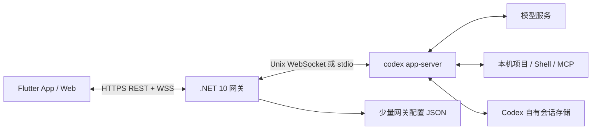

# 整体架构

状态：当前实现，2026-10-23。用户已确认首个后端运行环境为当前 Linux 电脑。

## 1. 产品范围

CodexLink 是一个自用、单用户、可由多个个人设备访问的 Codex 客户端。优先解决外出时连接不可靠、回到前台状态不清楚、发送是否成功无法判断的问题。

首版包含：配置一个服务地址、项目与线程列表、多轮对话与文件附件、流式回复、工具进度、审批、steer、原生 Goal、停止、断线重连和历史恢复；展示会话 Token、上下文窗口及占用、当前 Codex 账号今日/累计 Token 和可用的 5h/weekly 额度。App 与 Web 功能一致，界面使用 Material 3。Android 与 Web 先验收，iOS 使用相同工程补充构建验证。

这些能力按实施阶段逐步交付，但全部属于首版完成条件。交互与数据口径见 [产品与界面设计](product-design.md)。

首版不做：多租户、商业账户系统、自研公网中转、任意终端远控、复杂任务调度、第三方推送平台、多 Agent 编排界面，以及聊天内容的第二份服务端存储。Codex 自带的执行能力仍可按配置工作。

## 2. 运行结构

- **客户端**：展示数据、收集输入、管理连接状态；一个 Flutter 工程共享 App 和 Web。
- **网关**：单个 ASP.NET Core 进程，负责设备访问、输入边界、Codex 生命周期、事件分发和少量配置。
- **Codex**：优先连接官方共享 app-server；不存在时创建自有 stdio 进程。共享服务由原本的主机客户端管理，网关绝不终止它。
- **外网入口**：使用已有的 VPN/私网或受控 HTTPS 反向代理，不在产品里实现 NAT 穿透。

Flutter Web 生产构建和 API 使用同一源，Debug/Release 静态资源在 MSBuild 中生成并嵌入可执行文件，运行时流式提供，无旁置 wwwroot 或解包。TLS 可以在 loopback 前的私网入口/反向代理终止；部署方式与业务协议解耦。

## 3. Codex 接入与进程生命周期

默认读取 `codex app-server daemon version`，连接其 Unix socket 的 WebSocket `/rpc`；不存在共享服务时使用 `codex app-server --listen stdio://`。启动后完成 `initialize` 请求，确认成功后发送 `initialized` 通知。固定验证基线为共享服务 `0.157.1` 与独立 CLI `0.163.0`，升级时检查实际生成的 schema，只适配产品用到的部分。

协议层需要处理三种消息：带 ID 的响应、无 ID 的通知、Codex 主动发来的带 ID 请求。最后一种包括审批和用户补充输入，不能误当作通知丢弃。

进程管理保持轻量：

- stdout 持续读 JSON 消息，stderr 单独读日志；写 stdin 使用单一写入队列。
- 每个在途 RPC 有关联 ID、合理超时、明确的取消/退出处理；未知通知可以有界记录后忽略，stdio 未知服务端请求显式报不支持；共享连接不抢先否决由其他客户端处理的未知请求。
- 多个 HTTP 请求共享该进程，不为每条消息启动一个 Codex，不启动 TUI 或解析终端 ANSI 输出。
- 端口可用、Codex 握手成功、账号可用是不同状态；`/api/status` 分别报告。
- CLI 退出后让在途 RPC 失败，通知客户端。有限退避重启空闲运行时；重复启动失败后保持可诊断状态，允许显式重试，不高速循环拉起。
- 用户同意的任务在网关运行期独立于手机连接存在。请求进入任务操作后不能继承手机断连的取消 token。
- 共享模式下网关退出只断开自己的订阅；stdio 模式退出会停止自有子进程。两者均不把不确定任务自动重跑。重新连接后通过历史与运行状态核对。

Codex 的本机登录与配置由用户拥有。P1 先使用已经登录的 CLI，后续需要时再通过官方账号接口提供引导；网关不复制或下发模型认证文件。

## 4. 无业务数据库

首版**无需自建业务数据库**。这不代表 Codex 内部没有数据库，也不代表网关完全无状态。

| 数据 | 所有者 / 保存方式 | 重启后的行为 |
| --- | --- | --- |
| 线程、消息、执行历史 | Codex；通过 thread/list、thread/read 和历史分页接口获取 | 由 Codex 恢复可读取的历史 |
| Codex 账号与模型配置 | Codex 自己维护 | 沿用其认证流程 |
| 服务地址、允许的项目、运行参数 | 网关小型配置文件 | 启动时读取 |
| 设备名、随机访问令牌的摘要 | 网关 `config.json` 的 devices 字段 | 保持设备授权，可显式撤销 |
| RPC 关联、任务运行态、待审批请求 | 网关内存 | 重新向 Codex 核对；旧审批不可盲目重放 |
| 事件重放、发送去重 | 有界内存 | 清空；不承诺跨崩溃 exactly-once |
| 上传的图片或文件 | 网关专用目录 | 保留必要引用，按显式保留策略清理 |
| 附件 ID、文件名、大小、线程归属 | 附件旁的小型 JSON 元数据，不复制消息正文 | 支持重连/重启后识别附件，磁盘额度有上限 |
| Goal 与其预算/消耗 | Codex 原生 Goal 状态 | 通过 `thread/goal/get` 恢复 |
| 会话 Token / 上下文、账号用量 / 额度 | 官方事件或读取接口；网关只缓存最新快照 | 重新获取；未恢复前标未知，不伪造历史累计值 |
| 最近访问的线程、草稿 | 客户端轻量本地存储 | 恢复 UI，不作为历史真相来源 |

JSON 文件只保存小量、低频修改数据；单进程串行更新，写临时文件后原子替换。Linux 状态目录遵循 XDG，凭据文件限制当前用户读取；开发态状态写入已忽略的 `.local/`。

不扫描 Codex SQLite/JSONL 内部存储，不复制全部历史。持久化业务任务队列、复杂搜索或多用户需求实际出现后，才重新评估数据库。

## 5. 网关接口边界

以下为已实现的 v1 业务接口，具体 DTO 和错误码以 `server/CodexLink.Server` 为准；使用有限的业务接口隔离 Codex 协议变化。

| 接口 | 作用 / 底层映射 |
| --- | --- |
| `GET /api/status` | 网关、Codex、登录状态与版本；不使用付费请求探活 |
| `POST /api/auth/session` | 校验设备访问密钥，建立网页 Cookie |
| `DELETE /api/auth/session` | 清除网页登录；撤销设备由本机管理入口完成 |
| `GET /api/projects` / `POST /api/projects` | 分页读取/创建 Codex 原生项目 |
| `GET /api/directories` / `POST /api/directories` | 鉴权后浏览主机一级目录/创建文件夹 |
| `GET /api/threads` | 跨目录、来源、模型提供商的 `thread/list`；目录/标题/归档筛选与游标分页 |
| `POST /api/threads/{id}/archive` | 原生归档，稳定 requestId 回执 |
| `POST /api/threads/{id}/close` | 取消订阅、等待原生卸载，稳定 requestId 回执 |
| `POST /api/threads/{id}/unarchive` | 原生归档恢复 |
| `GET /api/threads/{id}/skills` | `skills/list`，按线程实际 cwd |
| `GET /api/threads/{id}/file-search` | `fuzzyFileSearch`，根限定线程 cwd |
| `GET /api/threads/{id}/mcp` | `mcpServerStatus/list`，真实连接/工具/资源 |
| `GET /api/threads/{id}/file` | 鉴权文件预览/下载，阻止目录穿越与符号链接逃逸 |
| `GET /api/media/{id}` | 规范化的生成图片/imageView/MCP 图片二进制 |
| `POST /api/threads` | `thread/start`，项目 ID 映射到服务端允许的目录 |
| `GET /api/threads/{id}` | `thread/read`，当前元数据和运行状态 |
| `GET /api/threads/{id}/items` | 通过官方历史分页接口取有限页内容 |
| `POST /api/attachments` | 流式上传，返回附件 ID、名称、大小与状态；限制项目/线程归属 |
| `GET /api/attachments/{id}` | 鉴权后获取附件，默认下载；图片走受限预览 |
| `DELETE /api/attachments/{id}` | 清理未引用上传；已引用文件只能经显式清理流程移除 |
| `POST /api/threads/{id}/turns` | 文本和附件 ID；必要时 resume，再 `turn/start` |
| `POST /api/threads/{id}/turns/{turnId}/steer` | 文本和附件 ID，映射 `turn/steer` 的 `expectedTurnId` |
| `GET/POST /api/threads/{id}/queue` | 读取/添加 CodexLink 创建的原生待发送输入 |
| `POST /api/threads/{id}/queue/{queuedId}/send` | 认领队列输入后 steer 当前轮次；空闲时原生 queue/start |
| `POST /api/threads/{id}/queue/{queuedId}/withdraw` | 原生删除成功后返回可恢复的正文、附件与引用 |
| `POST /api/threads/{id}/turns/{turnId}/interrupt` | 显式 `turn/interrupt` |
| `GET /api/threads/{id}/goal` | `thread/goal/get` |
| `PUT /api/threads/{id}/goal` | `thread/goal/set`，目标、状态、可选预算 |
| `DELETE /api/threads/{id}/goal` | `thread/goal/clear`；清除 Goal 不等于停止当前轮次 |
| `GET /api/threads/{id}/usage` | 最新会话 Token / 上下文快照；历史恢复不可用时明确说明 |
| `GET /api/account/usage` | 当前 Codex 登录账号的官方 Token 与额度，注明来源和更新时间 |
| `POST /api/approvals/{requestId}` | 回复仍有效的审批/补充输入请求 |
| `GET /api/events` | WebSocket，订阅状态、消息增量、工具、审批、Goal、用量与完成事件 |

模型/推理选项在日常使用阶段接入官方模型列表；所有端点对应实际界面需求，不做通用 RPC 代理。基础错误使用明确的 HTTP 状态与 Problem Details；事件包含可展示的错误类别。

消息使用 camelCase JSON；网关请求 DTO 明确类型，Codex 可变 payload 限制在适配层。RPC 的 `requestId`、线程 `threadId`、轮次 `turnId` 和内容 `itemId` 分开，不混为一个会话 ID。

普通写请求与事件传输分离：REST 负责操作，WebSocket 负责订阅/恢复与心跳。避免把 app-server 的完整 RPC 面直接暴露给手机。

## 6. 连接、重放和幂等

客户端连接状态至少区分：离线、连接中、已连接、重新同步、需要登录、Codex 不可用。网络不通时明确显示服务器不可达，不能展示为模型正在思考。

- **断线**：释放客户端订阅，不向 Codex 发 interrupt。移动设备回到前台时立即验证连接。
- **后台与恢复**：客户端隐藏/暂停时释放 WebSocket、心跳和重连定时器，已在途 HTTP 通过连接代次失效；回到前台重新订阅并读取当前会话快照。旧请求的成功、超时或 401 不得覆盖新连接，正常的临时传输故障通过连接状态展示。任务提醒使用独立通道，不能依赖后台聊天 WebSocket 保证送达。
- **重连**：网络恢复即尝试；连续失败使用带抖动、封顶的退避，避免多设备同步冲击。认证失败停止无效重试并显示重新登录。
- **事件**：网关为标准化事件提供 `epoch` 与递增 `seq`。进程重启后更换 epoch。
- **短暂掉线**：先订阅并暂存后续事件，从有界缓存重放缺失事件，再切换实时流。缓存按字节和时间限制，初始预算为总计 8 MiB / 最多 5 分钟，先达到哪个先淘汰。
- **缓存已过期或 epoch 改变**：明确返回需要重新同步，重新读取线程状态、有限历史和当前待审批项。同步期间暂存实时事件，以 item ID 合并权威完整项，避免快照与事件之间出现缺口或重复追加。
- **慢客户端**：每个连接独立有界发送队列，超限断开并要求恢复；不得堵住上游读循环，也不得静默丢弃审批和完成事件。
- **发送去重**：客户端生成 requestId；同设备同 ID 在进程存活的有限窗口内返回同一结果；同 ID 不同内容拒绝。记录在调用 Codex 前建立，去重缓存有容量和 TTL。
- **超时不明**：用同一 requestId 查询/核对；网关重启后缓存已失效时，提示核对最新轮次，由用户决定继续，不能换新 ID 自动重发。

初期同一线程只允许一个活动轮次；执行期间的补充内容从 v0.1.6 起进入原生队列，可立即 steer 或撤回；另行启动轮次返回忙碌状态。立即 steer 指定的轮次已结束时返回冲突并保留队列，不自动改成新任务；队列本身的本轮结束后发送由 Codex 原生调度。同一工作目录的并行写任务首版不开放；有实际需要再加入 worktree 隔离。

重连时同时恢复 Goal 和最新用量快照；累计 Token 事件是替换快照，不能再次累加。网关账号用量缓存按账号隔离，合并并发读取，以事件和界面访问触发更新，不用每台设备各自高频请求官方服务。

## 7. 最小安全方案

单用户、少量设备，不引入 OAuth 服务器或角色权限系统。

设备令牌由本机显式管理命令签发，至少 256 位随机；服务端只存摘要，配置文件不入库。原生 App 用 Bearer 与系统安全存储；Web 用 HTTPS 下的同源 HttpOnly、Secure、SameSite Cookie，持久凭据不进入 localStorage 或 URL。

Web 写请求验证 Origin 与内容类型，WebSocket 验证 Origin；只有 Bearer 原生请求可以没有浏览器 Origin。开发 CORS 只允许已配置的精确来源。基本登录限流与请求大小上限即可，不预建复杂风控。

网关默认监听 `0.0.0.0:47821`，启动显示有效 GUI 密钥和本机全部接口的 IPv4 访问地址。业务接口、事件与附件都必须鉴权。新建会话通过原生项目 ID/根目录或主机目录选择器确定 cwd，已有会话取 Codex 官方元数据；恢复不覆盖模型/目录/权限/Goal。文件上传使用服务器生成的 ID/路径，不接受客户端指定任意落盘位置。

Codex 默认保留合适的沙箱与按需审批。审批在所有已连接设备展示；第一个有效决定生效，随后广播已处理。重连只能获取仍然有效的请求，过期审批不允许再次执行。

请求日志保留状态码、request/thread/turn 标识和连接原因，不记录提示全文、文件内容或凭据；启动输出按用户要求显示 GUI 密钥，需按私有信息保管。私有来源访问本机接口 IP 时支持 HTTP Cookie 登录；配置 HTTPS publicOrigin 后使用 Secure Cookie。

## 8. 性能设计与验收预算

目标是低常驻开销、低延迟增量显示和长会话流畅，不以极端并发吞吐为目标。

- 后端使用异步流读取、有界 Channel 与明确所有权；避免每个事件反序列化后再转换多层通用对象。
- 订阅只发送相关线程详细事件和必要摘要；历史按需分页，不每次连接搬运全部历史。
- 文本增量按短时间窗口合并；前端约 30–50 ms 批量通知当前消息。任务结束立即刷新，完成项替换临时增量状态。
- Flutter 长列表惰性创建；Markdown/高亮按消息增量和完成状态缓存。图片生成缩略图，附件二进制流上传。
- 运行时按需缓存，不默认引入池化、后台轮询或长周期全量扫描。

初始验收预算（是目标，尚非实测结论）：

| 场景 | 验收目标 |
| --- | --- |
| 事件进入网关到本机订阅端收到 | 合成负载下 p95 < 50 ms，排除模型和公网耗时 |
| 手机流式阅读、滚动 | 目标 60 Hz 流畅，profile 检查超过帧预算的持续卡顿 |
| 长会话 | 1,000 条历史分页可浏览，不一次性构建全量 Widget |
| 弱网重连 | 恢复后无重复消息/审批，无虚假“发送成功” |
| 持续运行 | 2 小时事件回放与多次重连后内存不随累计事件无限增长 |
| 网页加载 | 单独记录冷启动资源体积与蜂窝网络首屏时间，不假设等同原生 App |

AOT 网关的启动、空闲内存和事件路径单独测量；Codex 子进程与模型等待单独统计。首次测量后再设内存预算，不用极小样例数据承诺正式产品峰值。

## 9. 参考与决策来源

- [Codex App Server](https://learn.chatgpt.com/docs/app-server)：协议能力与可分页历史；具体可用字段以固定版本 schema 为准。
- [Flutter 架构指南](https://docs.flutter.dev/app-architecture/guide)：采用轻量 UI/数据职责划分，复杂领域层按需。
- [Flutter 性能建议](https://docs.flutter.dev/perf/best-practices)：控制重建范围、列表与高成本绘制。
- AOT 具体约束和验证见 [native-aot.md](native-aot.md)；外网条件见 [部署设计](../deploy/README.md)。

## 已实现的协议适配

本机 Codex 0.163.0 的轮次列表 RPC 在运行时返回不支持。实现使用 `thread/read` 元数据、`thread/items/list` 分页与原生 turn 事件确定活跃轮次；网关重启后 `thread/resume` 恢复历史和官方用量。已通过真实附件读取、steer 和 Goal 验证，详见 [验收记录](verification.md)。

## 会话权限

App/Web 读取 `GET /api/threads/{id}/permissions` 的当前值及四档可用性，通过 `PUT` 提交一个 `preset`。服务端只接受 `read-only/default/auto-review/full-access`，分别映射到原生命名配置与审批策略；不提供任意权限 RPC 透传。新会话使用 `:workspace`、`on-request`、`user`，不覆盖恢复会话的设置。

选择时核对 `permissionProfile/list` 与 `configRequirements/read`，运行中的轮次/Goal 拒绝修改。`thread/settings/update` 的空响应不能作为最终状态，等待 `thread/settings/updated` 确认后回传，同一事件同步其他客户端。新建空会话尚无 rollout，因此不能为了读取权限而强制 `thread/resume`。现有自定义设置保留并明确标识。

## 任务通知（v0.1.3）

网关订阅 Codex 的 `turn/completed`，仅投影 completed/failed，忽略 interrupted；不轮询日志或私有数据库。`GET /api/notifications` 与 `/api/notifications/events` 均经设备/Bearer 或同源 Cookie 鉴权。后者使用 SSE，20 秒发送 ready 心跳；客户端使用 epoch/cursor 或 Last-Event-ID 断线补收，首次无游标只取得基线。单客户端写入超时 15 秒，不阻塞 Codex 读循环。

通知元数据仅含线程/轮次 ID、状态、时间，最多七天/256 条。进程内有界信号合并写入私有 `notifications.json`，临时文件原子替换；正常退出补写。客户端可读取 durable 判断当前游标是否已落盘，进程崩溃可能丢失尚未持久化的最近记录。过期、游标越界或 journal 损坏通过 gap/reset 表达，不伪装连续送达。恢复首次连接不补发全部旧任务。

Android `TaskNotificationService` 是用户明确开启的 specialUse 前台服务，直接保持轻量鉴权 SSE，无需云推送。POST_NOTIFICATIONS 与电池豁免均由用户动作申请；Activity 销毁不依赖 Flutter engine 运行服务。连接密钥由 Android KeyStore AES/GCM 加密，私有偏好仅保存密文、游标及最多 256 个去重 ID。稳定的会话标签替换未读通知，最多保留 20 张任务卡；点击身份与当前服务器/设备密钥摘要绑定，退出登录停止服务并清除密钥、游标和通知。401/403/404/重定向停止服务并提示；传输失败使用最长 30 秒退避。不能承诺强行停止、厂商冻结或真实移动网络下永不延迟。

Web 同源 EventSource 独立于聊天连接，页面隐藏时保留。获得系统权限后优先调用专用 `/notifications/` scope 的 service worker 显示/打开通知；其脚本不缓存或拦截资源，不覆盖 Flutter worker。系统不支持/权限未授予/显示失败时进入最多三条右上角气泡，隐藏期间不计消失时间；会话打开与当前浏览器登录身份绑定，退出清除游标及待打开会话。页面关闭后的实时 Web Push 和 iOS 后台推送尚未实现。

平台权限依据：[Android 前台服务类型](https://developer.android.com/develop/background-work/services/fgs/service-types)、[Doze 与电池豁免](https://developer.android.com/training/monitoring-device-state/doze-standby)、[浏览器系统通知](https://developer.mozilla.org/en-US/docs/Web/API/ServiceWorkerRegistration/showNotification)。

## 选项问答（v0.1.4）

`item/tool/requestUserInput` 保留原生请求 ID、问题 ID、选项说明、`isOther`、`isSecret` 与 `isBlocking`。回答经现有鉴权 `/api/approvals/{id}` 提交；服务端验证全部问题、单个非空答案、20,000 字符上限及封闭选项，再以原生 JSON-RPC result 返回。验证失败保留请求；写入串行，重复提交返回已失效。已开始写入但传输失败时不恢复请求，避免重复回答。`serverRequest/resolved` 与对应轮次完成清理入口，其他轮次完成不误清请求。非阻塞问题不停止任务动效，也不按超时自动选答案。

Codex CLI 0.163.0 的 `agentMessage.questions` 使用 `title/options`。v0.1.5 按同版本 TUI 的 `async_question_reply.rs` 发送完整 `<send_user_message_question_reply>` JSON 信封，记录 `questionItemId/question/answer`；ID 为紧凑 JSON 数组 `["request_user_input_async", 原始消息 ID, 原始问题索引]`。活动轮次通过捕获的 `expectedTurnId` 调用 `turn/steer`，空闲时 `turn/start`；复用既有 operation ID 与查询接口，轮次冲突不自动转新轮次，超时/断线只核对状态，不自动重发。TUI 据此移除对应待答项。CodexLink 同样从实时用户消息和分页历史解析完整信封，只忽略 skill/mention 输入，要求恰好一段文本；嵌入示例、残缺信封和带附件的消息保持普通文本。逐题解析、旧整消息 ID 兼容和提前到达的答案用于防止回放重现，索引不随部分回答重排。待答草稿最多 128 组、当前会话回答 ID 最多 8192 个，切换/退出清理 ID，历史按需恢复；答案正文不进入持久草稿。问题统一出现在输入框上方的扁平提示条，聊天历史只保留正文和可读的答案。

共享 Flutter 问答表单按协议显示单选、说明、自由回答、多问题与私密字段，不默认替用户选中/提交。最多 128 组问答草稿保存在 controller 内存中；切换会话或关闭弹窗可继续填写，客户端重启/退出清除，不写 SharedPreferences。网络失败保留内容；问题在另一客户端解决后，已打开的表单禁止提交。提交过程不读取或清理聊天草稿、附件、引用、模型、权限与 Goal。

## Android 返回与待发送输入（v0.1.6）

仅原生 Android 且宽度小于 960 时，会话列表通过根 Navigator 的 MaterialPageRoute 进入会话；Web 与其他平台继续使用原有切换。Android Diff 路由不再标记 fullscreenDialog，使 Flutter 自带 PredictiveBackPageTransitionsBuilder 可提供返回预览、取消及提交；Manifest 显式启用 OnBackInvokedCallback。预览、问答、附件抽屉与 Diff 使用同一个 Navigator；共享 AppController 不随路由复制，注销会关闭认证后的详情路由。

队列由 Codex `thread/queue/*` 保存和调度，网关不复制会话库。`clientUserMessageId` 使用 `codexlink-queue-` 前缀标记本网关创建的输入，并记录正文是否存在，使用户原文与附件/文件引用信封可无损区分；最多 16 条，每条正文不超过 200,000 字符，附件沿用原有限制。`thread/queue/changed` 经现有事件流传递，客户端合并短时间内的通知后只刷新队列，重连时读取快照。

立即发送的 delete 和 Codex 自动消费在原生队列中互斥，删除返回 false 时绝不再 steer。delete 与 steer 是两个原生 RPC，进程故障之间不承诺原子性：明确拒绝才重新排队，未知结果保留正文和稳定操作 ID；客户端将待核对动作保存在当前服务与会话的本地状态中，查询 `/api/operations` 或历史用户消息 `clientId`，不自动重发。操作回执仍采用有界的 30 分钟网关内存记录，跨网关重启可能不可恢复，界面保留人工核对后取回副本的入口。提问回答继续走独立的原生回答/结构化 steer 路径，不加入普通补充队列，也不清除聊天草稿。

## 会话列表操作（v0.1.7）

ThreadListTile 在原生触摸右滑、Web 鼠标悬停和键盘聚焦时展开右侧按钮。active 状态使用明暗主题对应的青绿色与“运行中”文本；关闭按钮仅在运行且没有等待卸载时出现。水平方向手势不接管纵向列表滚动；操作期间禁用行内重复提交。

归档调用 `thread/archive`，恢复调用 `thread/unarchive`；关闭调用 `thread/unsubscribe`，不通过临时归档模拟卸载。`unsubscribed` 只代表取消本网关订阅，返回 closing；`notLoaded` 或真实 `thread/closed` 才表示卸载完成。`notSubscribed` 返回 409，保留真实状态。原生实例仍活跃、存在其他订阅或未达到原生卸载延迟时显示等待状态。关闭不自动中断轮次或暂停 Goal，也不终止共享 daemon。原生延迟由 Codex 配置决定，网关不擅自修改。

关闭成功或结果未知后，网关在当前进程内阻止普通快照刷新触发 resume；显式打开使用 `GET /api/threads/{id}?reopen=true`，保留原有工作目录、模型、权限和 Goal。该标志是有界会话缓存的一部分，不保证跨网关重启持久保存。客户端切换只读状态并保留草稿、附件和引用。列表事件使用逐字段版本合并，较早 HTTP 列表不能覆盖较新的归档或状态事件；重连重同步同时读取列表。操作使用现有的设备隔离、30 分钟/1024 项回执，结果不明确时只查询回执，不自动重发。
